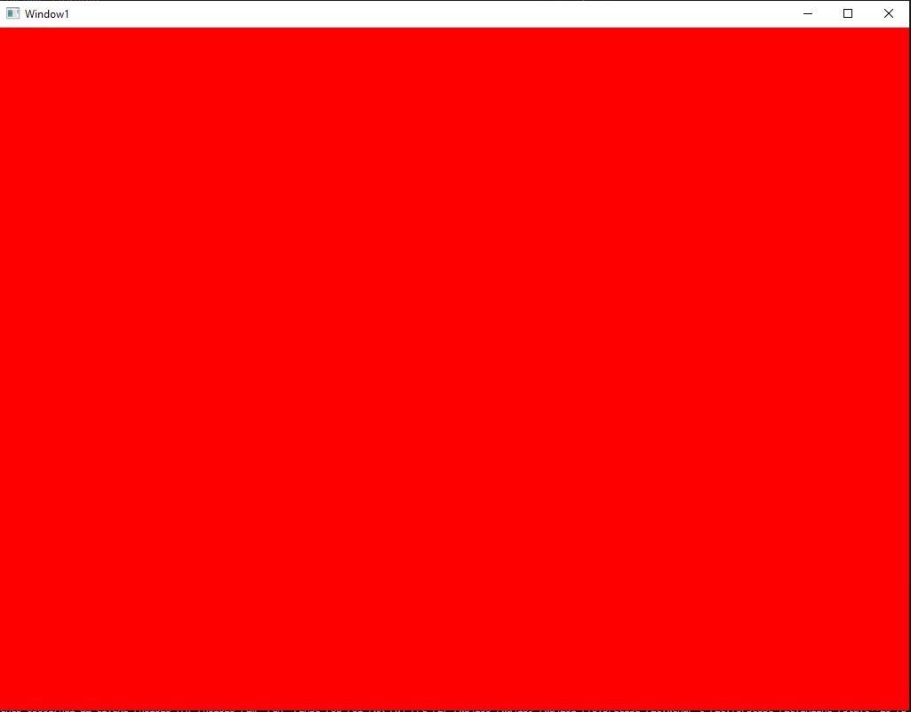

# Our first render - a window into the world

It's not much to look at yet, but it is an important milestone: our engine opened its very first window and rendered its first frame.

Behind this simple window is the groundwork for everything that follows:

* Window creation and input handling
* A first version of the render loop
* The basic connection between the platform layer and the game code

Over the next weeks we will focus on the general program structure, so that rendering, game logic and networking can grow independently of each other.
